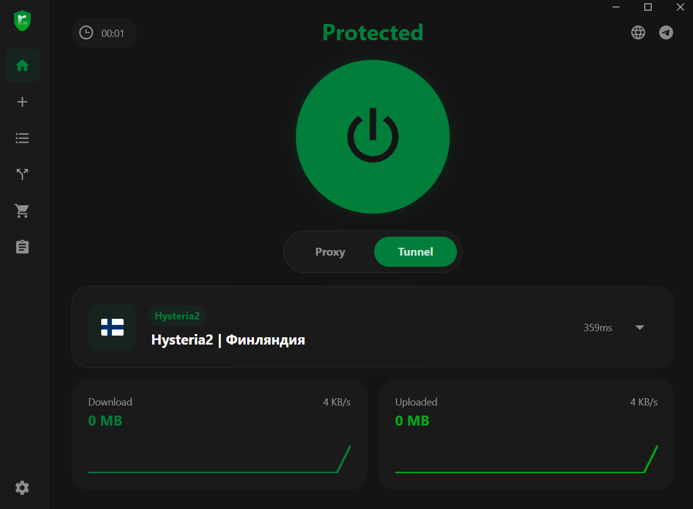
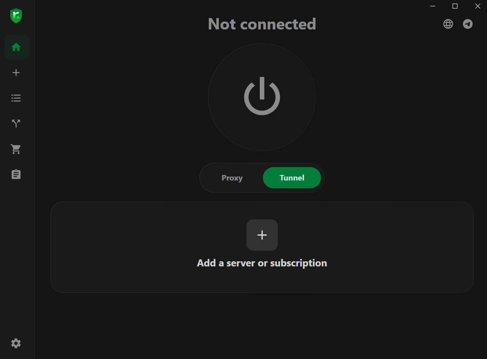
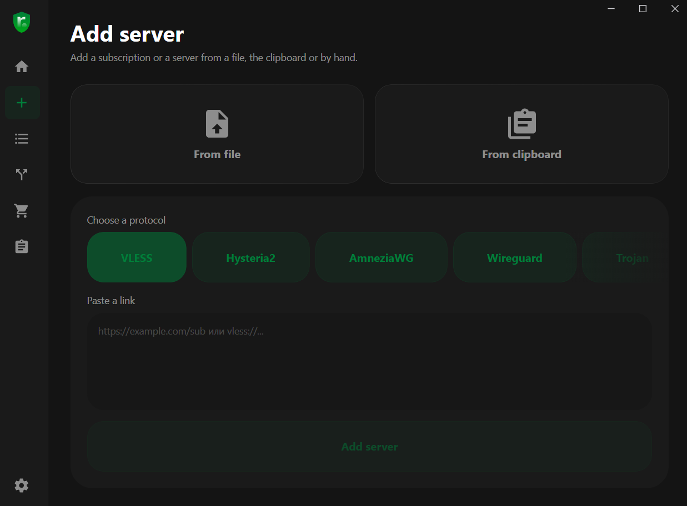
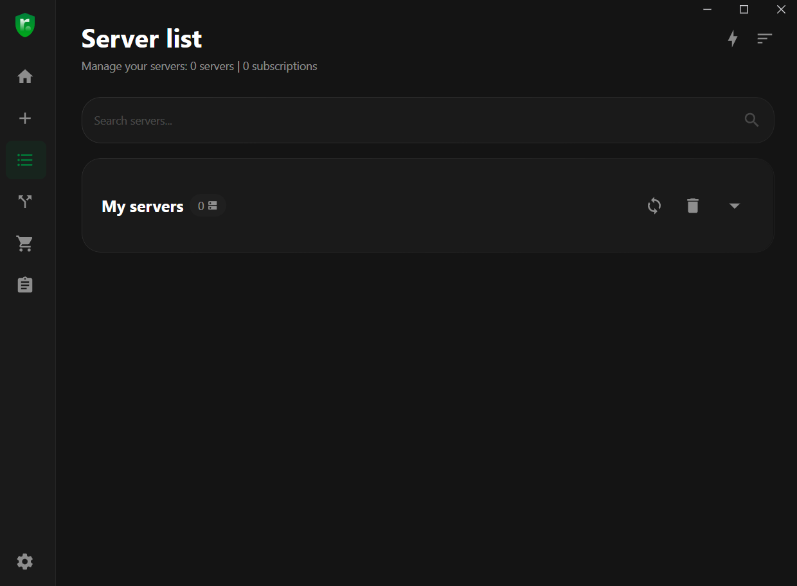
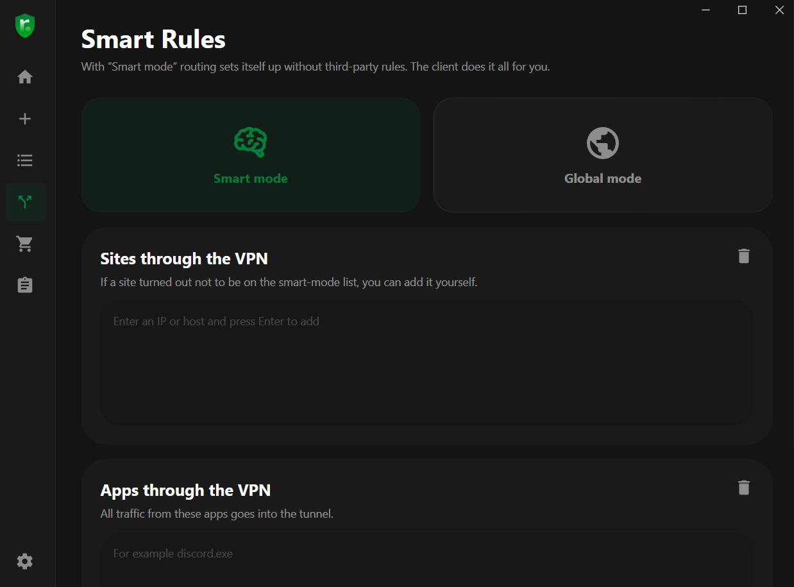
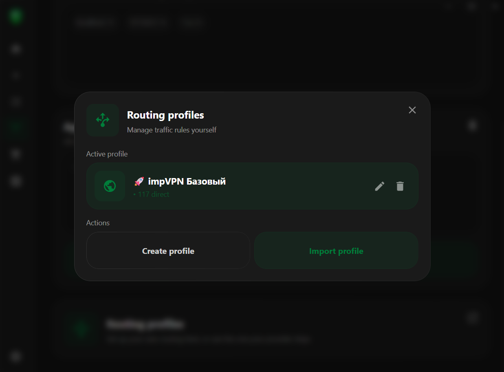
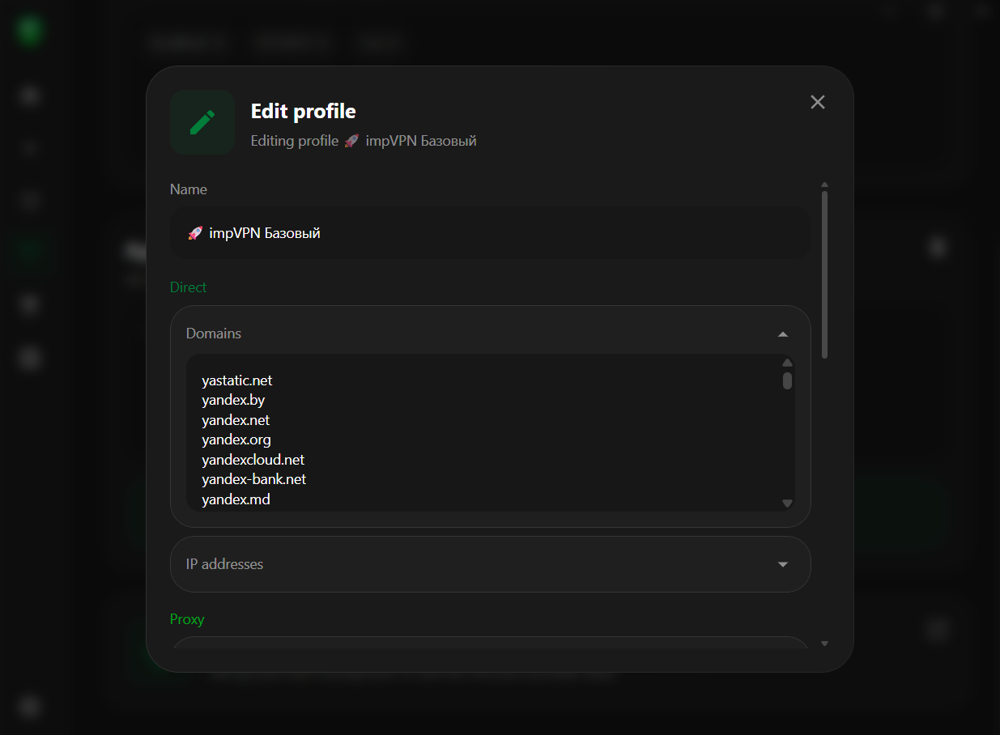
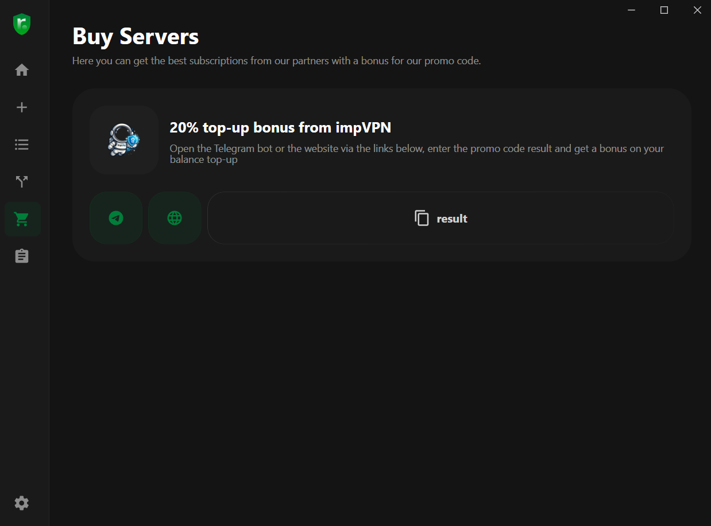
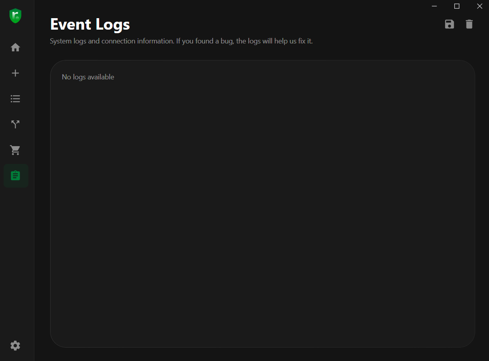
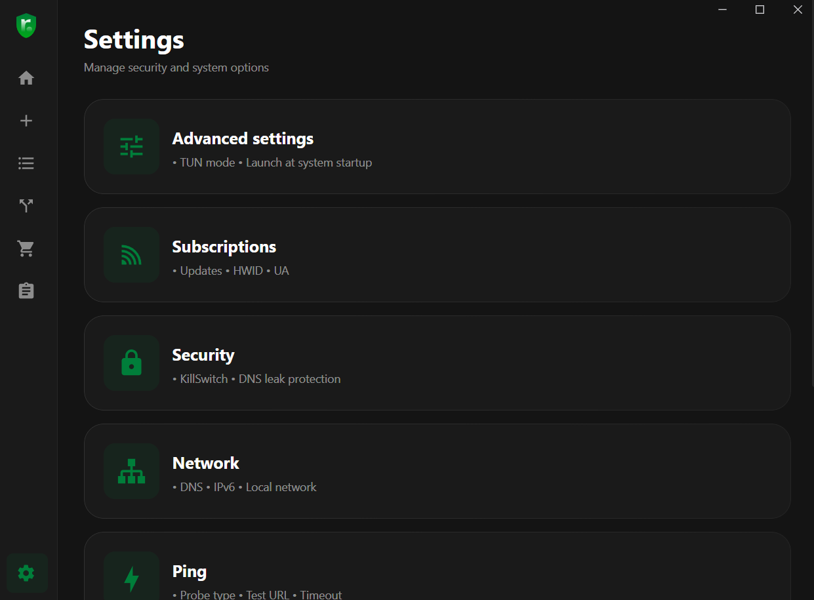

<p align="center">
  
</p>

<h1 align="center">ResultV</h1>

<p align="center">
  <b>Desktop VPN and proxy client for Windows (macOS/Linux support in beta): Wails, Go, and sing-box.</b><br>
  Smart routing, subscriptions, rule profiles, and system integration in one app.
</p>

<p align="center">
  
  
  
  
  
</p>

<p align="center">
  <a href="#features">Features</a> •
  <a href="#user-guide">User guide</a> •
  <a href="#development">Development</a> •
  <a href="#building">Building</a> •
  <a href="https://result-proxy.ru/">Website</a>
</p>

<p align="center">
  <a href="./README.md">Русский</a> | <b>English</b>
</p>

<p align="center">
  <b>Website and downloads:</b> <a href="https://result-proxy.ru/">result-proxy.ru</a> • <b>Telegram channel:</b> <a href="https://t.me/resultvpn">@resultvpn</a>
</p>

<p align="center">
  
</p>

---

## Overview

ResultV **3.5.6** is a native desktop application built with **[Wails v2](https://wails.io/)**. The UI is **React 18** with **Vite** and **Tailwind CSS**; traffic is handled by a **Go** backend and **[sing-box 1.14](https://github.com/SagerNet/sing-box)** (the [sing-box-extended](https://github.com/shtorm-7/sing-box-extended) build, with project-specific build tags in `wails.json`). The interface is localized with **i18next** (English and Russian).

**Prebuilt releases:** GitHub Actions publishes **Windows amd64** artifacts (portable `.exe` and NSIS installer), **macOS** (`.dmg`) and **Linux** (`.AppImage`, `.deb`, `.rpm`) when a `v*` tag is pushed.

---

## Installation

Prebuilt binaries live on the **[Releases](https://github.com/AandStep/ResultV/releases/latest)** page — you do **not** need to build from source with Wails.

### Windows

Download the `*-installer.exe` (or the portable `.exe`) and run it.

### macOS

Download `ResultV.dmg`, open it and drag the app into `Applications`.

### Linux

The universal option for every distro is the **AppImage** — no installation required:

```bash
chmod +x ResultV*.AppImage
./ResultV*.AppImage
```

If the AppImage doesn't start, install FUSE (`fuse2`): on Debian/Ubuntu — `sudo apt install libfuse2`, on Fedora — `sudo dnf install fuse`, on Arch/CachyOS — `sudo pacman -S fuse2`. If WebKitGTK 4.1 is missing, the AppImage offers to install it.

**Arch / CachyOS (and other Arch-based):** the AppImage runs natively (just needs `fuse2`, see above). The `.deb`/`.rpm` packages do not install directly — use the AppImage.

**NixOS:** the AppImage **does not run directly** — the system has no standard FHS loader. Run it through a wrapper:

```bash
nix-shell -p appimage-run --run "appimage-run ./ResultV*.AppImage"
```

Or enable automatic AppImage execution in `configuration.nix` and rebuild:

```nix
programs.appimage.enable = true;
programs.appimage.binfmt = true;
```

After that the AppImage launches with a plain `./ResultV*.AppImage`.

**Debian / Ubuntu** — `.deb`: `sudo apt install ./ResultV*.deb`
**Fedora / RHEL / openSUSE** — `.rpm`: `sudo dnf install ./ResultV*.rpm` (or `sudo zypper install`).

> Current builds target `linux/amd64` (x86_64).

---

## Features

**Connection**
- **Proxy** (system proxy) and **Tunnel** (TUN — all system traffic, including apps that ignore the system proxy) modes
- **Protocols:** HTTP(S), SOCKS5, **VLESS** (including Reality), **VMess**, **Trojan**, **Shadowsocks**, **Hysteria2**, **NaiveProxy**, **WireGuard**, **AmneziaWG** (up to 3.1)
- **Auto servers:** for subscription AUTO groups the client picks the best node by latency, UDP support and throughput, and fails over to the next one when a node stops responding
- Live session timer, speed and traffic totals on the home screen

**Routing**
- **Smart mode** — only blocked resources go through the VPN, everything else goes direct. Lists are built from open sources (Re:filter, itdog and others), including Telegram and Discord voice subnets
- **Global mode** — all traffic goes through the VPN, with site and app exclusions
- Your own lists of **sites** and **apps** to send through the VPN or direct (apps by `.exe` name or file path)
- **Routing profiles** (Global mode only) — your own Direct / Proxy / Block rules for domains and IPs with `geosite:` / `geoip:` support, rule order, and import by link; a profile can also come from your subscription provider
- **Adaptive smart mode** (experimental) — the client detects blocking by itself instead of relying on a list

**Subscriptions and servers**
- Add by subscription link, share link, clipboard or file (`.txt` / `.csv` / `.conf` / Xray and sing-box JSON), manually via the editor, or via a `resultv://` deep link
- Scheduled auto-update, per-subscription interval, **HWID** and custom **User-Agent**
- Subscription expiry date and traffic left, renaming, hiding a subscription from the home screen
- Search, sorting (by country, type, provider, ping), favorites, drag-and-drop group order
- **Ping:** auto (matched to the node protocol), ICMP, or an HTTP request through the node itself; custom test URL and timeout

**Security and system**
- **Kill Switch** and **DNS leak protection**
- DNS choice (Google, Cloudflare, Quad9, Yandex or your own), IPv6 in the tunnel, TUN stack choice (system / gvisor)
- Sharing the proxy to the **local network** with a chosen port
- Password-protected **encrypted export/import** of the configuration
- **Autostart**, **system tray** (connect, pick a server, disconnect)
- **Built-in updater** with integrity check of the downloaded file and a changelog after the update
- **Event log** that can be saved to a file for diagnostics

---

## Supported protocols and constraints

| Category | Protocols |
|----------|-----------|
| Classic proxy | HTTP, HTTPS, SOCKS5 |
| VPN stack (sing-box) | VLESS, VMess, Trojan, Shadowsocks, Hysteria2, NaiveProxy, WireGuard, AmneziaWG |
| Transports | TCP, WebSocket, HTTPUpgrade, gRPC, HTTP/2, XHTTP, mKCP; TLS and Reality; multiplex |

**Important:**

- **WireGuard** and **AmneziaWG** work only in **Tunnel** mode; they are unavailable in Proxy mode.
- **AmneziaWG** — full set of obfuscation fields: classic `Jc/Jmin/Jmax`, packet sizes `S1–S4`, headers `H1–H4`, AWG 2.0 signature packets `I1–I5` + `Itime`, AWG 3.0 header protection and timings, AWG 3.1 random trailers and disabled cookie replies. Fields are set in the server editor or in JSON mode. URIs of the form `awg://...?Jc=5&Jmin=10&Jmax=50&S1=16&I1=...&Itime=300` are accepted (both lower and upper case — AmneziaVPN clients provide `Jc/Jmin/...`).
- **Hysteria2** supports port hopping (`mport`), **Shadowsocks** supports SIP003 plugins.
- Subscriptions in **JSON** (Xray format with `outbounds[]` and sing-box format with `type`) are parsed for all key protocols, including `wireguard`/`amneziawg` with an `amnezia` block. Routing rules embedded in a subscription are picked up automatically.
- The "apps through the VPN" list works only in **Tunnel** mode.
- **Tunnel** mode on Windows requires **running as Administrator**. After a restart with administrator rights, the selected server connects automatically.
- **Kill Switch** on Windows may require **administrator privileges** for firewall rules.
- If internet remains blocked after a crash or forced app termination, run in **PowerShell (Administrator)**:
  `Get-NetFirewallRule -DisplayName 'ResultV_KillSwitch*' -ErrorAction SilentlyContinue | Remove-NetFirewallRule`
- Some subscription providers enforce **HWID device limits**; the app sends a stable `x-hwid` when fetching subscriptions and shows the reason if the provider returned an empty response due to the limit. Sending HWID can be turned off in settings.
- **In case of issues**, write to the [community chat on Telegram](https://t.me/+nIOT_k5HJmo4YzUy) — tech support works there. Attach the saved event log.

---

## User guide

Screenshots below show the **English** UI (files in [`docs/images/readme/`](./docs/images/readme/)).

### Home

The connect button, the **Proxy** / **Tunnel** switch and the current server — the arrow opens a list to switch nodes quickly. While there are no servers, the add button lives here.

<p align="center">
  
</p>

While connected you see the session time, node latency, speed, and downloaded and uploaded traffic.

<p align="center">
  
</p>

### Add server

Import **from a file** or **from the clipboard**, or paste a subscription link or a share link for the chosen protocol. WireGuard and AmneziaWG configs are pasted whole. Before a subscription is added you get a preview: how many servers it has and which routing rules it brings.

<p align="center">
  
</p>

### Server list

Servers are grouped by subscription and "My servers". Each group has ping, refresh and delete; each server can be edited and starred. At the top are search, latency check and sorting. Groups can be dragged: hold a card for a second, and the order is kept on the home screen too.

<p align="center">
  
</p>

### Smart rules

**Smart mode** sends only blocked resources through the VPN, the rest goes direct — nothing to configure. If a site is missing from the list, add it to "Sites through the VPN" (along with all its subdomains); apps that connect to bare IPs (for example Discord voice) go to "Apps through the VPN".

In **Global mode** everything goes through the VPN and the lists become exclusions: "Sites direct" and "Apps direct".

<p align="center">
  
</p>

### Routing profiles

At the bottom of the Smart rules page are routing profiles, your own rule sets: what goes direct, what goes through the VPN, and what gets blocked. A profile can be created, imported by a link from the clipboard, or received from your subscription provider — it applies right away. Profiles are available only in **Global mode**.

<p align="center">
  
</p>

The profile editor sets domains and IPs for **Direct**, **Proxy** and **Block** (`geosite:` and `geoip:` are supported), the rule order by drag-and-drop, and custom GeoIP / GeoSite database URLs.

<p align="center">
  
</p>

### Buy servers

The **Buy** tab links to partner offers ([impVPN:telegram](https://t.me/impVPNBot?start=NzQ3MDczMjUz)), ([impVPN:site](https://my.impio.space/?ref=NzQ3MDczMjUz)) - Best VPN servers at affordable prices, and with the promo code **result** a 20% bonus to the balance top-up. You can skip this step if you already have a server or a subscription.

<p align="center">
  
</p>

### Event logs

System logs and connection information. The log can be saved to a file and attached to a bug report.

<p align="center">
  
</p>

### Settings

Settings are split into sections:

- **Advanced settings** — TUN stack, launch at system startup, interface language, password-protected config export/import
- **Subscriptions** — auto-update and its interval, sending HWID, custom User-Agent
- **Security** — Kill Switch and DNS leak protection
- **Network** — DNS servers, IPv6 in the tunnel, proxy access from the local network and the local port
- **Ping** — probe type (auto, ICMP, HTTP GET / HEAD through the node), test URL and timeout
- **Experimental** — adaptive smart mode

<p align="center">
  
</p>

---

## Updates

The app compares its version with [`update.json`](https://raw.githubusercontent.com/AandStep/ResultV/main/update.json) on the `main` branch. When a new version is out, ResultV offers to update: it downloads the build for its platform, checks its SHA-256 against the manifest, installs it and restarts. A changelog is shown after the update.

---

## Development

### Prerequisites

- **Go:** version compatible with [`go.mod`](./go.mod) (see `go` and `toolchain` directives)
- **Node.js:** **20+** recommended (CI uses **24** for releases)
- **Wails CLI v2:** `go install github.com/wailsapp/wails/v2/cmd/wails@latest`
- **Windows:** WebView2 runtime (usually present on current Windows 10/11)

### Run in dev mode

From the repository root:

```bash
wails dev
```

This starts the Vite dev server with hot reload and connects it to the Go backend.

---

## Building

### Local production build

```bash
wails build
```

Add `-nsis` on Windows to produce an installer if NSIS is installed:

```bash
wails build -nsis
```

macOS and Linux have the `build-macos.sh` and `build-linux.sh` scripts. Outputs land under `build/bin/` (see [`build/README.md`](./build/README.md)).

### CI releases

The [`.github/workflows/release.yml`](./.github/workflows/release.yml) workflow builds Windows, macOS and Linux on a `v*` tag, computes artifact SHA-256 for `update.json` and publishes a GitHub Release.

---

## Tech stack

| Layer | Technology |
|-------|------------|
| Shell | [Wails v2](https://wails.io/) |
| UI | React 18, Vite, Tailwind CSS, i18next |
| Backend | Go |
| Proxy core | sing-box 1.14 ([sing-box-extended](https://github.com/shtorm-7/sing-box-extended)), project build tags in [`wails.json`](./wails.json) |
| Tray | [energye/systray](https://github.com/energye/systray), native menu |

---

## License

This project is licensed under the **GNU General Public License v3.0** — see [`LICENSE`](./LICENSE).
