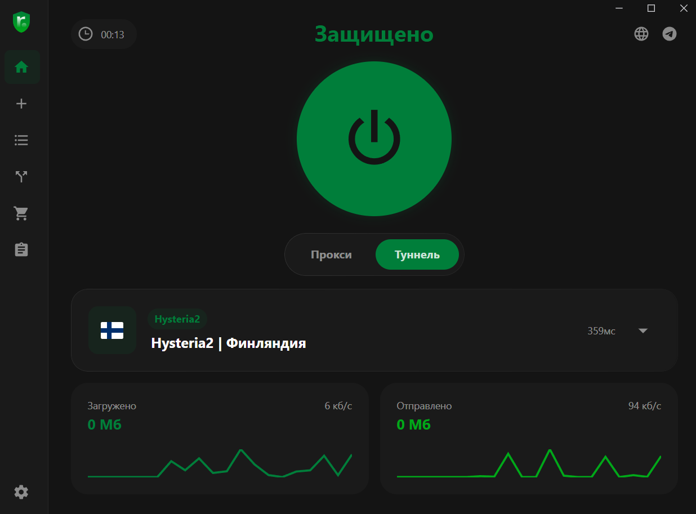
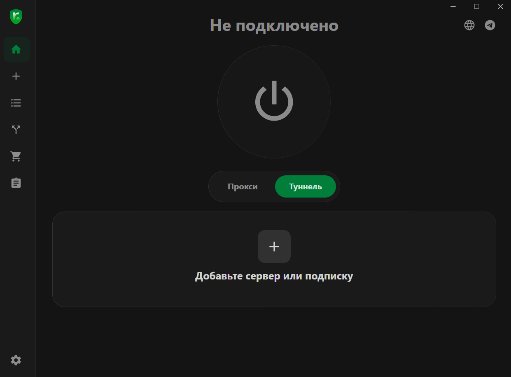
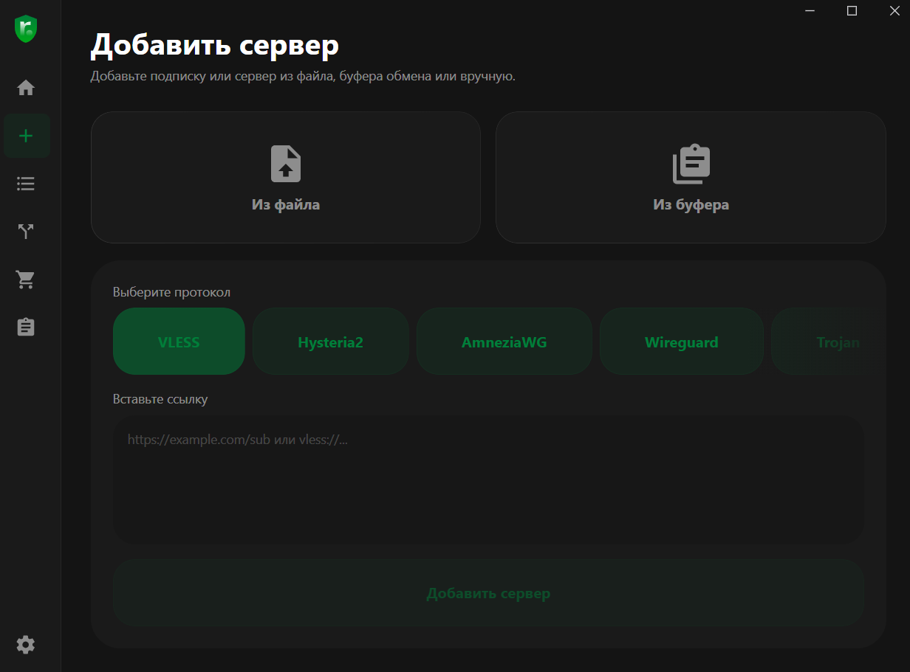
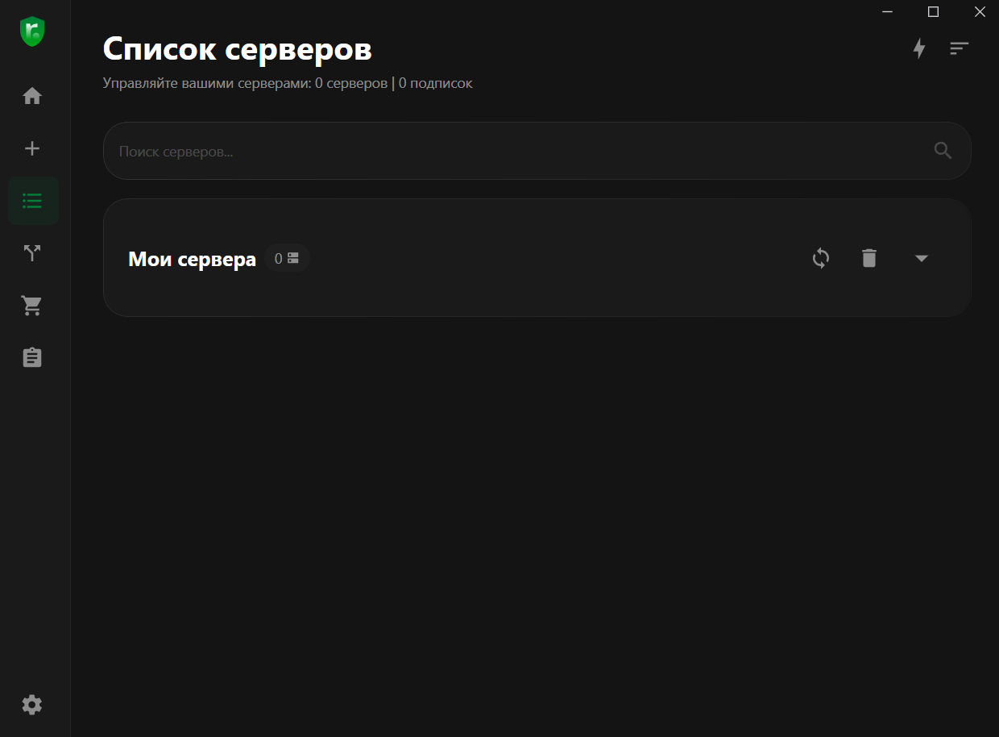
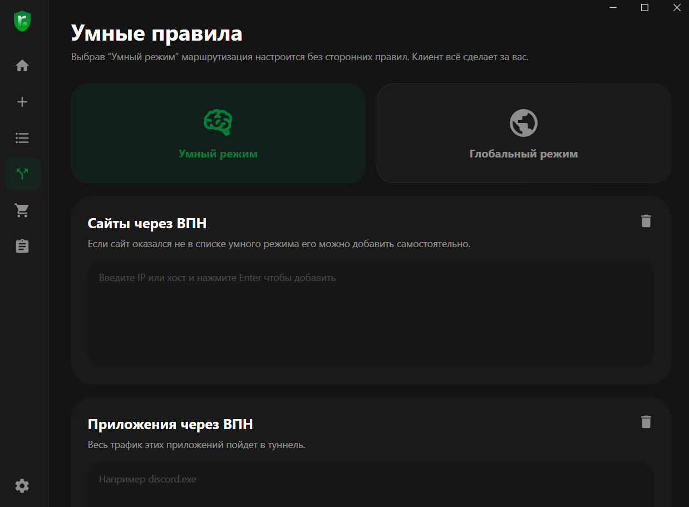
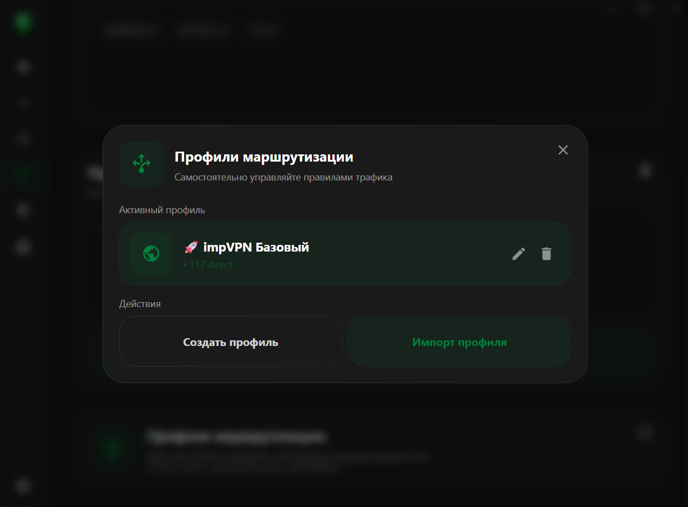
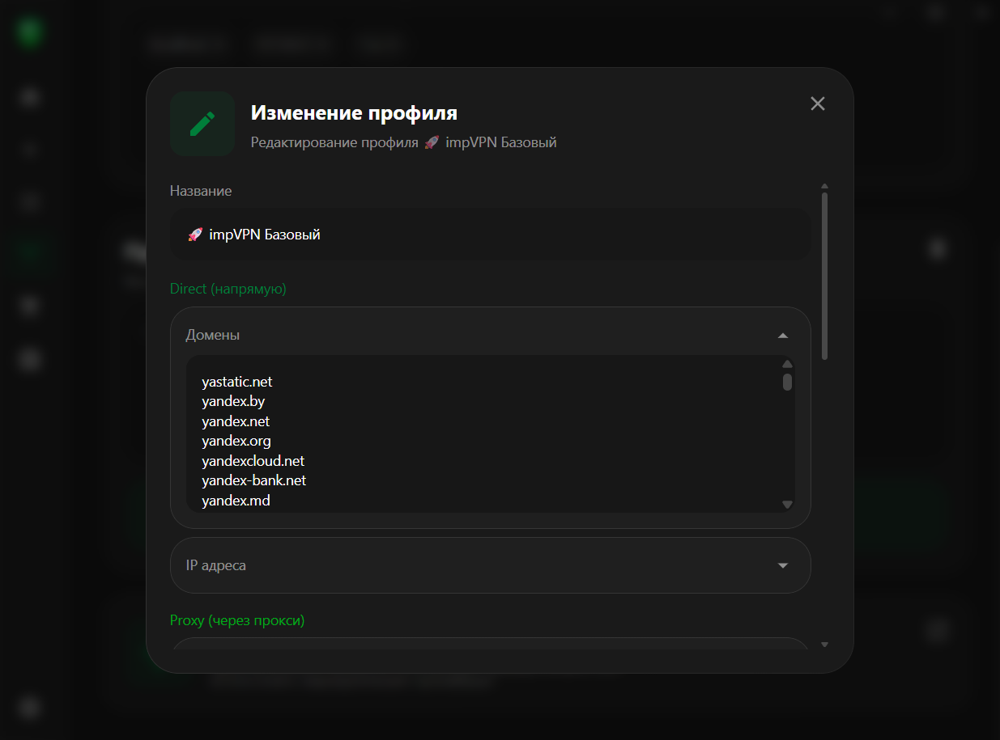
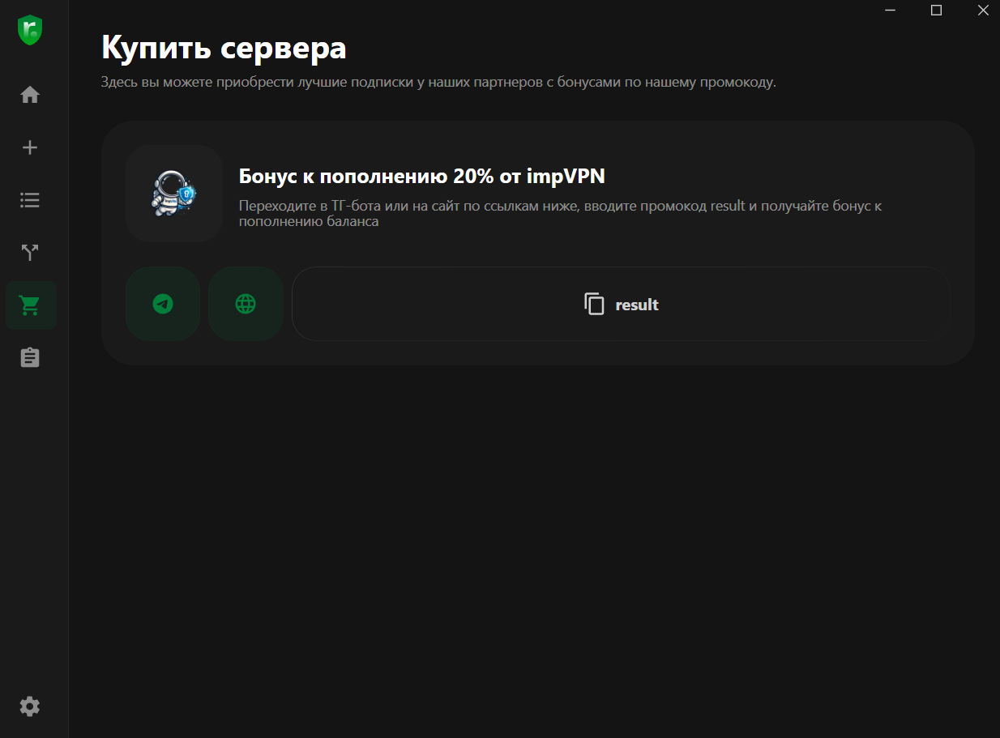
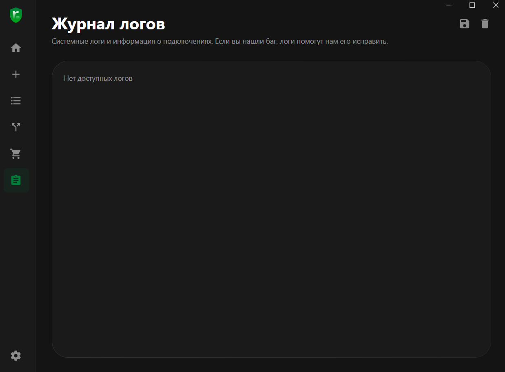
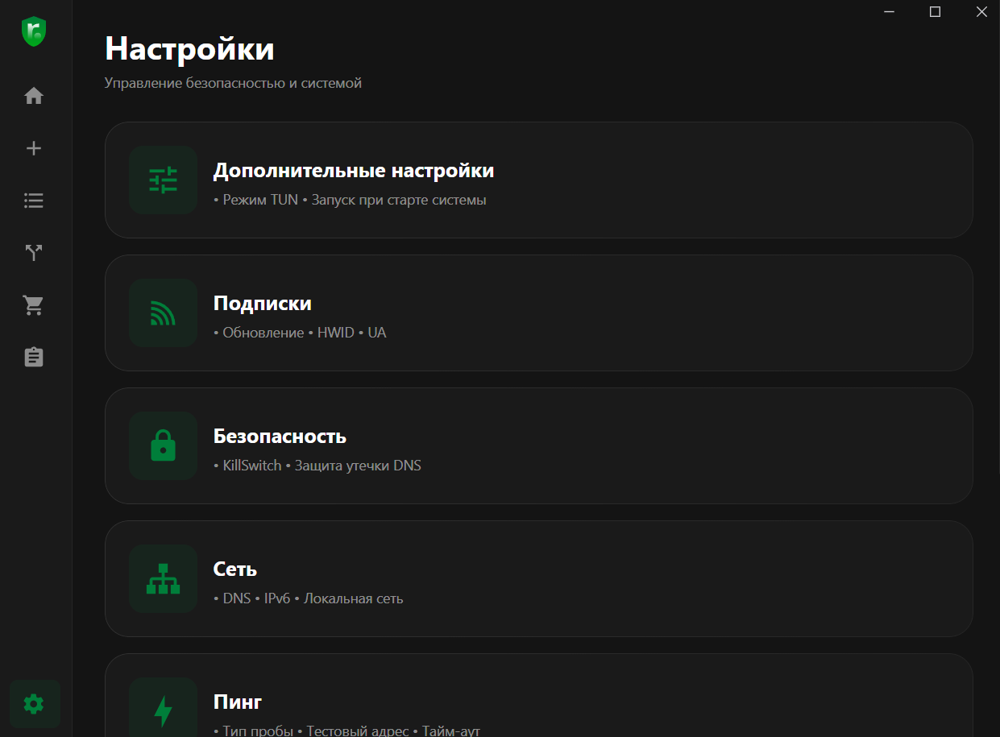

<p align="center">
  
</p>

<h1 align="center">ResultV</h1>

<p align="center">
  <b>Настольный клиент для ВПН и прокси на Windows (поддержка macOS/Linux в бета тесте): Wails, Go и sing-box.</b><br>
  Умная маршрутизация, подписки, профили правил и интеграция с системой в одном приложении.
</p>

<p align="center">
  
  
  
  
  
</p>

<p align="center">
  <a href="#возможности">Возможности</a> •
  <a href="#руководство-пользователя">Руководство</a> •
  <a href="#разработка">Разработка</a> •
  <a href="#сборка">Сборка</a> •
  <a href="https://result-proxy.ru/">Сайт</a>
</p>

<p align="center">
  <b>Русский</b> | <a href="./README.en.md">English</a>
</p>

<p align="center">
  <b>Сайт и загрузки:</b> <a href="https://result-proxy.ru/">result-proxy.ru</a> • <b>Telegram-канал:</b> <a href="https://t.me/resultvpn">@resultvpn</a>
</p>

<p align="center">
  
</p>

---

## О проекте

ResultV **3.5.6** — нативное настольное приложение на **[Wails v2](https://wails.io/)**. Интерфейс: **React 18**, **Vite**, **Tailwind CSS**; трафик обрабатывает бэкенд на **Go** и движок **[sing-box 1.14](https://github.com/SagerNet/sing-box)** (сборка [sing-box-extended](https://github.com/shtorm-7/sing-box-extended), теги сборки заданы в `wails.json`). Локализация через **i18next** (русский и английский).

**Готовые сборки:** в GitHub Actions публикуются артефакты **Windows amd64** (portable `.exe` и установщик NSIS), **macOS** (`.dmg`) и **Linux** (`.AppImage`, `.deb`, `.rpm`) при push тега `v*`.

---

## Установка

Готовые сборки лежат на странице **[Releases](https://github.com/AandStep/ResultV/releases/latest)** — собирать через Wails вручную **не нужно**.

### Windows

Скачайте установщик `*-installer.exe` (или portable `.exe`) и запустите.

### macOS

Скачайте `ResultV.dmg`, откройте и перетащите приложение в `Applications`.

### Linux

Для всех дистрибутивов универсальный вариант — **AppImage**, отдельная установка не нужна:

```bash
chmod +x ResultV*.AppImage
./ResultV*.AppImage
```

Если AppImage не стартует, поставьте FUSE (`fuse2`): на Debian/Ubuntu — `sudo apt install libfuse2`, на Fedora — `sudo dnf install fuse`, на Arch/CachyOS — `sudo pacman -S fuse2`. Если в системе нет WebKitGTK 4.1, AppImage сам предложит его установить.

**Arch / CachyOS (и другие Arch-based):** AppImage работает нативно (нужен только `fuse2`, см. выше). Пакеты `.deb`/`.rpm` напрямую не ставятся — используйте AppImage.

**NixOS:** AppImage **не запускается напрямую** — в системе нет стандартного FHS-загрузчика. Запуск через обёртку:

```bash
nix-shell -p appimage-run --run "appimage-run ./ResultV*.AppImage"
```

Либо включите автоматический запуск AppImage в `configuration.nix` и пересоберите систему:

```nix
programs.appimage.enable = true;
programs.appimage.binfmt = true;
```

После этого AppImage запускается обычным `./ResultV*.AppImage`.

**Debian / Ubuntu** — `.deb`: `sudo apt install ./ResultV*.deb`
**Fedora / RHEL / openSUSE** — `.rpm`: `sudo dnf install ./ResultV*.rpm` (или `sudo zypper install`).

> Текущие сборки — `linux/amd64` (x86_64).

---

## Возможности

**Подключение**
- Режимы **Прокси** (системный прокси) и **Туннель** (TUN — весь трафик системы, включая приложения, которые игнорируют системный прокси)
- Протоколы: HTTP(S), SOCKS5, **VLESS** (включая Reality), **VMess**, **Trojan**, **Shadowsocks**, **Hysteria2**, **NaiveProxy**, **WireGuard**, **AmneziaWG** (до версии 3.1)
- **Авто-серверы:** для AUTO-групп подписки клиент сам выбирает лучший узел по задержке, UDP и пропускной способности и переключается на следующий, если узел перестал отвечать
- Таймер сессии, скорость и объём трафика на главной в реальном времени

**Маршрутизация**
- **Умный режим** — в ВПН идут только заблокированные ресурсы, всё остальное напрямую. Списки собираются из открытых источников (Re:filter, itdog и др.), включая подсети Telegram и голосовых серверов Discord
- **Глобальный режим** — весь трафик через ВПН, с исключениями по сайтам и приложениям
- Свои списки **сайтов** и **приложений** через ВПН или напрямую (приложения — по имени `.exe` или пути к файлу)
- **Профили маршрутизации** (только в Глобальном режиме) — свои правила Direct / Proxy / Block по доменам и IP с поддержкой `geosite:` / `geoip:`, порядок применения и импорт профиля по ссылке; профиль может прийти и от провайдера подписки
- **Адаптивный умный режим** (экспериментально) — клиент сам определяет блокировки, не полагаясь на список

**Подписки и серверы**
- Добавление по ссылке подписки, share-ссылке, из буфера обмена или файла (`.txt` / `.csv` / `.conf` / JSON Xray и sing-box), вручную через редактор, а также по диплинку `resultv://`
- Автообновление по расписанию, свой интервал для каждой подписки, передача **HWID** и своего **User-Agent**
- Срок действия и остаток трафика подписки, переименование, скрытие подписки с главной
- Поиск, сортировка (по стране, типу, провайдеру, пингу), избранное, перетаскивание групп
- **Пинг:** авто (под протокол узла), ICMP или HTTP-запросом через сам узел; свой тестовый адрес и тайм-аут

**Безопасность и система**
- **Kill Switch** и **защита от утечки DNS**
- Выбор DNS (Google, Cloudflare, Quad9, Яндекс или свои адреса), IPv6 в туннеле, выбор стека TUN (system / gvisor)
- Раздача прокси в **локальную сеть** с выбором порта
- **Зашифрованный экспорт/импорт** конфигурации с паролем
- **Автозапуск**, работа из **системного трея** (подключение, выбор сервера, отключение)
- **Встроенное обновление** с проверкой целостности загруженного файла и списком изменений после обновления
- **Журнал логов** с сохранением в файл для диагностики

---

## Протоколы и ограничения


| Категория           | Протоколы                                                                   |
| ------------------- | --------------------------------------------------------------------------- |
| Классический прокси | HTTP, HTTPS, SOCKS5                                                         |
| VPN-стек (sing-box) | VLESS, VMess, Trojan, Shadowsocks, Hysteria2, NaiveProxy, WireGuard, AmneziaWG |
| Транспорты          | TCP, WebSocket, HTTPUpgrade, gRPC, HTTP/2, XHTTP, mKCP; TLS и Reality; multiplex |


**Важно:**

- **WireGuard** и **AmneziaWG** работают только в режиме **Туннель**, в режиме Прокси недоступны.
- **AmneziaWG** — полный набор полей обфускации: классические `Jc/Jmin/Jmax`, размеры `S1–S4`, заголовки `H1–H4`, signature-пакеты AWG 2.0 `I1–I5` + `Itime`, защита заголовков и тайминги AWG 3.0, случайные хвосты и отключение cookie-ответов AWG 3.1. Поля задаются в редакторе сервера или в режиме JSON. Принимаются URI вида `awg://...?Jc=5&Jmin=10&Jmax=50&S1=16&I1=...&Itime=300` (в нижнем и верхнем регистре — клиенты AmneziaVPN отдают `Jc/Jmin/...`).
- **Hysteria2** поддерживает port hopping (`mport`), **Shadowsocks** — плагины SIP003.
- Подписки в **JSON** (Xray-формат с `outbounds[]` и sing-box-формат с `type`) разбираются для всех ключевых протоколов, включая `wireguard`/`amneziawg` с блоком `amnezia`. Правила маршрутизации, встроенные в подписку, подхватываются автоматически.
- Приложения в списке «через ВПН» работают только в режиме **Туннель**.
- Режим **Туннель** в Windows требует **запуска от имени администратора**. После перезапуска с правами администратора выбранный сервер подключается автоматически.
- **Kill Switch** в Windows может требовать **прав администратора** для правил брандмауэра.
- Если после сбоя/принудительного завершения приложения интернет остается заблокирован, выполните в **PowerShell (Администратор)**:
  `Get-NetFirewallRule -DisplayName 'ResultV_KillSwitch*' -ErrorAction SilentlyContinue | Remove-NetFirewallRule`
- Некоторые провайдеры подписок используют **HWID-ограничение устройств**; приложение передает стабильный `x-hwid` при загрузке подписок и показывает причину, если провайдер вернул пустой ответ по лимиту. Передачу HWID можно выключить в настройках.
- **При сбоях** пишите в [общий чат в Telegram](https://t.me/+nIOT_k5HJmo4YzUy) — там работает техподдержка. Приложите сохранённый журнал логов.

---

## Руководство пользователя

Скриншоты ниже показывают **русский** интерфейс (файлы в [`docs/images/readme/`](./docs/images/readme/)).


### Главная

Кнопка подключения, переключатель **Прокси** / **Туннель** и текущий сервер — по стрелке раскрывается список для быстрой смены узла. Пока серверов нет, здесь же кнопка добавления.

<p align="center">
  
</p>

При активном соединении видны время сессии, задержка до узла, скорость и объём загруженного и отправленного трафика.

<p align="center">
  
</p>


### Добавить сервер

Импорт **из файла** или **из буфера обмена**, вставка ссылки подписки или share-ссылки нужного протокола. Конфиги WireGuard и AmneziaWG вставляются целиком. Перед добавлением подписки показывается превью: число серверов и правила маршрутизации, которые она принесёт.

<p align="center">
  
</p>


### Список серверов

Серверы сгруппированы по подпискам и «Моим серверам». Для каждой группы — пинг, обновление и удаление; для сервера — редактирование и избранное. Сверху — поиск, замер задержки и сортировка. Группы можно перетаскивать: зажмите карточку на секунду, и порядок сохранится и на главной.

<p align="center">
  
</p>


### Умные правила

**Умный режим** отправляет в ВПН только заблокированные ресурсы, остальное идёт напрямую — настраивать ничего не нужно. Если нужного сайта нет в списке, его можно добавить в «Сайты через ВПН» (вместе со всеми поддоменами), а приложения, которые ходят по голым IP (например, голос в Discord), — в «Приложения через ВПН».

В **Глобальном режиме** через ВПН идёт всё, а списки превращаются в исключения: «Сайты напрямую» и «Приложения напрямую».

<p align="center">
  
</p>


### Профили маршрутизации

Внизу страницы «Умные правила» — профили маршрутизации, собственные наборы правил: что пустить напрямую, что через ВПН, а что заблокировать. Профиль можно создать, импортировать по ссылке из буфера обмена или получить от провайдера подписки — он применяется сразу. Профили доступны только в **Глобальном режиме**.

<p align="center">
  
</p>

В редакторе профиля задаются домены и IP для **Direct**, **Proxy** и **Block** (поддерживаются `geosite:` и `geoip:`), порядок обработки правил перетаскиванием и свои ссылки на базы GeoIP / GeoSite.

<p align="center">
  
</p>


### Купить серверы

Вкладка **Купить** ведёт на партнёрские предложения ([impVPN:telegram](https://t.me/impVPNBot?start=NzQ3MDczMjUz)), ([impVPN:site](https://my.impio.space/?ref=NzQ3MDczMjUz)) - Лучшие ВПН сервера по доступным ценам, а по промокоду **result** бонус 20% к пополнению баланса. Если у вас уже есть сервер или подписка, шаг можно пропустить.

<p align="center">
  
</p>


### Журнал логов

Системные логи и информация о подключениях. Журнал можно сохранить в файл и приложить к сообщению о баге.

<p align="center">
  
</p>


### Настройки

Настройки разбиты на разделы:

- **Дополнительные настройки** — стек TUN, запуск при старте системы, язык интерфейса, экспорт/импорт конфигурации с паролем
- **Подписки** — автообновление и его интервал, передача HWID, свой User-Agent
- **Безопасность** — Kill Switch и защита от утечки DNS
- **Сеть** — DNS-серверы, IPv6 в туннеле, доступ к прокси из локальной сети и локальный порт
- **Пинг** — тип пробы (авто, ICMP, HTTP GET / HEAD через узел), тестовый адрес и тайм-аут
- **Экспериментально** — адаптивный умный режим

<p align="center">
  
</p>

---

## Обновления

Приложение сверяет свою версию с [`update.json`](https://raw.githubusercontent.com/AandStep/ResultV/main/update.json) в ветке `main`. Когда выходит новая версия, ResultV предлагает обновиться: скачивает сборку для своей платформы, сверяет её SHA-256 с манифестом, устанавливает и перезапускается. После обновления показывается список изменений.

---

## Разработка

### Требования

- **Go:** совместимый с [`go.mod`](./go.mod) (директивы `go` и `toolchain`)
- **Node.js:** **20+** (в CI для релизов используется **24**)
- **Wails CLI v2:** `go install github.com/wailsapp/wails/v2/cmd/wails@latest`
- **Windows:** среда выполнения WebView2 (обычно уже есть в Windows 10/11)

### Запуск в режиме разработки

Из корня репозитория:

```bash
wails dev
```

Запускается Vite с горячей перезагрузкой и связь с Go-бэкендом.

---

## Сборка

### Локальная production-сборка

```bash
wails build
```

На Windows при установленном NSIS можно добавить установщик:

```bash
wails build -nsis
```

Для macOS и Linux есть скрипты `build-macos.sh` и `build-linux.sh`. Результат в `build/bin/` (см. [`build/README.md`](./build/README.md)).

### Релизы в CI

[`.github/workflows/release.yml`](./.github/workflows/release.yml) по тегу `v*` собирает Windows, macOS и Linux, считает SHA-256 артефактов для `update.json` и публикует GitHub Release.

---

## Стек технологий


| Слой        | Технологии                                                                                         |
| ----------- | -------------------------------------------------------------------------------------------------- |
| Оболочка    | [Wails v2](https://wails.io/)                                                                      |
| UI          | React 18, Vite, Tailwind CSS, i18next                                                              |
| Бэкенд      | Go                                                                                                 |
| Прокси-ядро | sing-box 1.14 ([sing-box-extended](https://github.com/shtorm-7/sing-box-extended)), теги сборки в [`wails.json`](./wails.json) |
| Трей        | [energye/systray](https://github.com/energye/systray), нативное меню                               |


---

## Лицензия

Проект распространяется под **GNU General Public License v3.0** — см. [`LICENSE`](./LICENSE).
